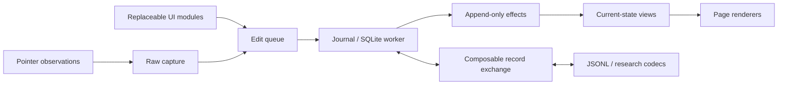

# Event Draw

**e.** A browser notebook for handwriting, PDF/image/SVG annotation and Markdown/math,
with inspectable raw captures, immutable processing outputs and a SQLite edit journal.
The core and exchange APIs are reusable without the UI.

## Try it

[Open the app](https://imbrem.github.io/event-draw/)
in Safari on your iPad or a desktop browser. No sign-in is required.
No Xcode or macOS update is needed for browser use.

For fullscreen iPad use: **Safari → Share → Add to Home Screen**, enable **Open as Web App**
if shown, then launch its icon. Portrait and landscape are both supported. The production
app caches its static shell for offline use; embedded PDF/image sources stay in the notebook.
**Menu → Install Event Draw** reports offline readiness and offers updates. Updates wait for
an explicit **Save & update**, which flushes drafts before reloading. Export/import SQLite if
Safari and the Home Screen app use separate storage.

- New blank notes are **growing canvases**: scroll vertically and keep writing; ink and text extend the page.
  A notebook can mix these with fixed A4/Letter pages, PDFs, images, SVGs and free-panning whiteboards.
  **Menu → Document → New note layout** chooses a growing canvas or fixed pages.
- On touch devices, **Notes workspace** fills the screen width with a floating palette. Pencil draws;
  fingers scroll by default and two fingers pan/pinch. **Menu → Workspace** selects Notes or Page view
  on any platform. Rotation changes the view, preserving stored coordinates.
- The compose icon creates a writing note. **Menu → Pages** inserts other page types or more writing space.
- Draw with Pen or Highlighter; choose a common color or a custom one.
- Adjust width in the dock (eraser size is its diameter). **Menu → Toolbar → Minimal**
  keeps tools, undo/redo, colors and thickness; other controls move into Menu.
  Labels hide when space is limited; the label setting can override this.
- Choose **A** (or **T**), tap the page and type Markdown with `$LaTeX$`, or choose plain text.
  Double-click text to edit; drag to move and use selection handles to resize/rotate. **Notes** manages linked notes/properties.
- **⌘/Ctrl+Z** undoes; **⌘/Ctrl+Shift+Z** or **Ctrl+Y** redoes. Text editors keep native undo.
- **Notebooks** in the header opens the library: create, rename, or switch separate SQLite notebooks.
- Edit the document title in the header. Numbered pages have separate stable identities.
- **Menu** opens PDFs by file/URL, inserts pages/images/SVGs and exposes raw/event viewers and diagnostics.
- **Menu → Export** saves a notebook, a reduced notebook, annotated PDF or typed JSONL events.
- **Reconstruct from JSONL** imports full or filtered history and reports missing dependencies.

Each notebook has its own SQLite database. A separate app/config SQLite database holds the
local catalog, notebook names and active selection. Existing local work is adopted in place.
SQLite exports embed source blobs by default; import adds a separate library copy.
Export files to move between devices; there is no sync server.

**Schema UUID + SemVer (`0.0.0`):** older local notebooks need **Menu → Local state → Reset local notebook**.
Export existing SQLite first if needed. There are no migrations or silent resets.

## Develop

Node 24+ and pnpm:

```sh
pnpm install
pnpm dev             # http://localhost:5173
pnpm build           # static app + DOM-free JS/TS core in dist/
pnpm preview         # production app at http://localhost:4173
pnpm test
pnpm exec playwright install webkit   # once; Chrome is also needed locally
pnpm test:browser    # uses the running dev server
```

Use trusted HTTPS on tablets for persistent storage. LAN HTTP may provide only a temporary
session; check the storage indicator. Desktop tests cannot establish real pencil sampling,
palm rejection or tablet latency. See [tablet testing](docs/reference.md#testing-on-a-tablet).

CLI experiments preserve their inputs and refuse to overwrite an existing output:

```sh
pnpm compact notebook.sqlite3 drawn.sqlite3 --drawn
pnpm events export notebook.sqlite3 events.jsonl
pnpm events replay events.jsonl reconstructed.sqlite3
pnpm events export notebook.sqlite3 experiment.jsonl --adapter ./trusted-exchange.ts
pnpm detect notebook.sqlite3 ./trusted-detector.mjs
pnpm bench:strokes notebook.sqlite3  # lossless JSON/CBOR + zstd comparison
pnpm bench:eraser                   # sustained batch vs incremental geometry
```

## Stack and choices

| Part | Dependencies / choice |
| --- | --- |
| App | TypeScript 7, Vite 8, vanilla DOM + Canvas 2D. Small focused modules; no UI framework or server. |
| Notebooks | Official SQLite WASM 3.54.1 in a worker; OPFS persistence and a separate app/catalog SQLite file. Node tools inject `node:sqlite`. |
| Traces | `cborg` 6 + `@bokuweb/zstd-wasm` 0.0.27: lossless CBOR + zstd, replaceable per payload. |
| Content | PDF.js 6.4; markdown-it 15 + KaTeX 0.19; pdf-lib 1.17 + html2canvas-pro 2.5 for PDF export. PDF fonts/decoders ship locally. |
| Installation | Web manifest + generated static-shell service worker; no additional PWA dependency. Both root and Pages subpath hosting work. |
| Checks | Node 24+ test runner, Playwright Chrome/Chromium + WebKit; pnpm 12 lockfile. |

`package.json` describes compatible dependency ranges; `pnpm-lock.yaml` pins reproducible installs.
The DOM-free core is JavaScript/TypeScript, not yet a Rust or general WASM plugin ABI.
[Stack and portability](docs/stack.md) explains each adapter and the remaining device limits.

## Architecture



- **Observations:** raw pen/contact data and clocks, stored as pluggable CBOR + zstd payloads; style, tool, placement and edit times stay separate.
- **Artifacts:** immutable, versioned trace outputs, content and detections with provenance.
- **Edits:** complete effects determine the current scene; replay does not rerun processors.
- **Identity:** 256-bit notebook namespace; mutable objects use namespace + logical timestamp and local integer aliases.
- **Exchange:** replaceable source/sink, payload bindings, transforms, framing and replay policy. JSONL is one default.
- **Extensions:** trusted frontend modules receive state subscriptions and queued commands; processing, lasso, detection,
  content storage/editing/rendering, playback, footer indicators and content backends have separate interfaces.

Read the [architecture and extension examples](docs/README.md),
[feature/schema reference](docs/reference.md), [trace formats/compression results](docs/trace-storage.md),
[stack and portability](docs/stack.md), and [SQLite schema](src/schema.sql).
The [CI workflow](.github/workflows/pages.yml) tests production builds in Chromium/WebKit
and deploys `main` to the public Pages site after checks pass.
