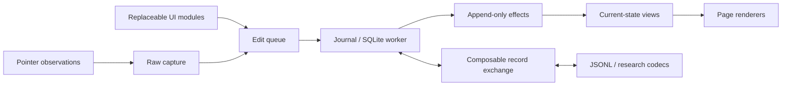

# Event Draw

**e.** A browser notebook for handwriting, PDF/image/SVG annotation and Markdown/math,
with inspectable raw captures, immutable processing outputs and a SQLite edit journal.
The core and exchange APIs are reusable without the UI.

## Try it

[Open the internal app](https://sturdy-bassoon-w9lk351.pages.github.io/)
in Safari on your iPad or a desktop browser. Sign in to GitHub with repository read access.
No Xcode or macOS update is needed for browser use.

- Draw with Pen or Highlighter; choose a common color or a custom one.
- Choose **A** (or **T**), tap the page and type Markdown with `$LaTeX$`, or choose plain text.
  Double-click text to edit; drag to move and use selection handles to resize/rotate. **Notes** manages linked notes/properties.
- **⌘/Ctrl+Z** undoes; **⌘/Ctrl+Shift+Z** or **Ctrl+Y** redoes. Text editors keep native undo.
- Edit the document title in the header. Numbered pages have separate stable identities.
- **Menu** opens PDFs by file/URL, inserts pages/images/SVGs and exposes raw/event viewers and diagnostics.
- **Menu → Export** saves a notebook, a reduced notebook, annotated PDF or typed JSONL events.
- **Reconstruct from JSONL** imports full or filtered history and reports missing dependencies.

The app stores one working notebook per browser profile/origin. SQLite files embed source
blobs by default; export files to move between devices. Open/import replaces the working
copy after retaining recovery data. There is no sync server.

**Schema UUID + SemVer (`0.0.0`):** older local notebooks need **Menu → Local state → Reset local notebook**.
Export existing SQLite first if needed. There are no migrations or silent resets.

## Develop

Node 24+ and pnpm:

```sh
pnpm install
pnpm dev             # http://localhost:5173
pnpm build           # static app + DOM-free JS/TS core in dist/
pnpm preview         # production app at http://localhost:4173
pnpm test
pnpm exec playwright install webkit   # once; Chrome is also needed locally
pnpm test:browser    # uses the running dev server
```

Use trusted HTTPS on tablets for persistent storage. LAN HTTP may provide only a temporary
session; check the storage indicator. Desktop tests cannot establish real pencil sampling,
palm rejection or tablet latency. See [tablet testing](docs/reference.md#testing-on-a-tablet).

CLI experiments preserve their inputs and refuse to overwrite an existing output:

```sh
pnpm compact notebook.sqlite3 drawn.sqlite3 --drawn
pnpm events export notebook.sqlite3 events.jsonl
pnpm events replay events.jsonl reconstructed.sqlite3
pnpm events export notebook.sqlite3 experiment.jsonl --adapter ./trusted-exchange.ts
pnpm detect notebook.sqlite3 ./trusted-detector.mjs
pnpm bench:strokes notebook.sqlite3  # lossless JSON/CBOR + zstd comparison
```

## Architecture



- **Observations:** raw pen/contact data and clocks, stored as pluggable CBOR + zstd payloads; style, tool, placement and edit times stay separate.
- **Artifacts:** immutable, versioned trace outputs, content and detections with provenance.
- **Edits:** complete effects determine the current scene; replay does not rerun processors.
- **Identity:** 256-bit notebook namespace; mutable objects use namespace + logical timestamp and local integer aliases.
- **Exchange:** replaceable source/sink, payload bindings, transforms, framing and replay policy. JSONL is one default.
- **Extensions:** trusted frontend modules receive state subscriptions and queued commands; processing, lasso, detection,
  content storage/editing/rendering, playback, footer indicators and content backends have separate interfaces.

Read the [architecture and extension examples](docs/README.md),
[feature/schema reference](docs/reference.md), [trace formats/compression results](docs/trace-storage.md),
and [SQLite schema](src/schema.sql).
The [CI workflow](.github/workflows/pages.yml) tests production builds in Chromium/WebKit
and deploys `main` to the private Pages site after checks pass.
