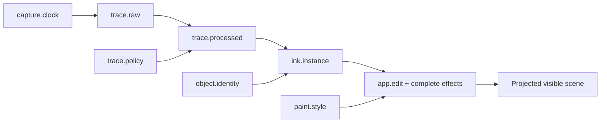

# Architecture and experiments

[Project setup](../README.md) · [Feature reference](reference.md) · [Schema](../src/schema.sql)

Keep raw evidence, derived values, mutable instances and editing history separate.
A research change to processing, exchange or UI should reuse the other boundaries.

## Modules

| Boundary | Modules | Responsibility |
| --- | --- | --- |
| Capture | `capture.ts`, `model.ts` | Preserve observations, optional fields, coalesced/predicted batches and clocks |
| Processing | `ink.ts`, `plugins.ts`, `live-ink.ts` | Versioned smoothing/width/rejection and validated immutable outputs |
| Interaction | `interactions.ts`, `geometry.ts` | Replaceable lasso and touch transforms; vector erasing |
| Persistence | `journal.ts`, `storage/*`, `schema.sql` | Transactions, immutable resources, append-only effects and projections |
| Identity | `storage/identity.ts`, `storage/events.ts` | Namespaces, logical clock, object registry and lifecycle events |
| Exchange | `streams.ts`, `storage/event-stream.ts` | Framing, record bindings, transforms and reconstruction policy |
| Materialization | `storage/record-materialization.ts`, `storage/snapshot.ts` | SQLite row dependencies/replay and reduced baselines |
| Frontend | `frontend.ts`, `ui/extensions.ts`, `ui/*` | Host API, managed trusted extensions and focused controls |
| Content | `content.ts`, `page-sources.ts`, `ui/content-renderers.ts` | Replaceable byte backend, page backgrounds and positioned content |
| Analysis | `detection.ts`, `pipelines.ts`, `transformations.ts` | Box script/provenance and future async recognition contracts |
| Transport | `database.ts`, `db.worker.ts`, `state-transport.ts` | Worker RPC, OPFS persistence and incremental scene updates |

`app.ts` coordinates the default shell and shared edit queue. It does not define raw capture
schemas or exchange framing. `core.ts` builds a DOM-free JS library with TypeScript declarations;
frontend rendering modules remain a separate browser layer.

## Identity

| Table | Role |
| --- | --- |
| `notebook_imports(id, uuid)` | Integer namespace aliases, including self; UUID is 32 random bytes as 64 hex digits |
| `notebook_metadata` | Self namespace, original creation time and persistent logical-clock high-water mark |
| `object_ids` | Integer object alias, namespace import ID, timestamp, kind and optional domain-local ID |

A mutable object's global identity is `(notebook UUID, timestamp_us)`. Documents, pages,
placed ink shapes and page-content instances are mutable objects. A page keeps its identity
when renamed, reordered or given a different background. Immutable raw/processed traces are
values referenced by those instances; they do not receive mutable-object identities.

The allocator uses `max(Date.now() * 1000, last_timestamp_us + 1)` inside the transaction.
It guarantees increasing, unique **logical** microseconds per notebook writer, including
bursts and clock rollback. This is not a claim of microsecond wall-clock accuracy.
`referenceObject` registers external identities without requiring a local materialization.
A self-reference advances the allocator as well.

Creating a notebook assigns its namespace once. Reopening it preserves its identity and
creation time; each browser opening records `app.open` with a capture-session/clock reference.
Opening/importing another notebook records `notebook.open`. Document/page creation, naming,
placement and deletion are journal effects. The initial blank document/page is represented
by `notebook.create` effects, rather than an implicit fallback in current-state queries.

SQL domain IDs (`pages.id`, `shapes.id`, etc.), generic object aliases (`object_ids.id`) and
exchange record IDs are distinct integer namespaces. Foreign identities map through imports;
there is no implemented cross-notebook merge. Independently editing copies with the same
namespace will require writer/fork namespaces or another collision policy before merging.

## Event values and rendering



SQLite retains normalized tables for efficient inspection and rendering. Exchange records
make raw traces, processed traces, policies, identities, content, detections and edits all
typed events in one output sequence. No paint or selected tool is added to raw trace JSON.
Browser contact width/height, pointer type and buttons are observations, not paint settings.

Raw local coordinates start at the contact's first measured point; placement is an edit.
Capture/session clocks remain unchanged. Processed vertices map back through `sourceIndex`;
replay shares time zero with the first measured raw sample. Removing early points does not
silently move later output to time zero.

Complete per-object edit effects determine visibility, placement, style and content.
`current_pages`, `current_documents`, `visible_shapes` and `visible_objects` project the
latest effects. Mutable document/page tables are rebuildable FK/name caches. Replay restores
effects and baked output, without depending on today's processor or command behavior.

## Composable exchange

The default adapter is `event-draw/records@1`. It is an experiment, not a canonical standard.

```mermaid
flowchart LR
  DB[SQLite / another source] --> Collect[Record source]
  Collect --> Bind[Payload bindings]
  Bind --> Out[Outbound transforms]
  Out --> Codec[Framing codec]
  Codec --> Lines[JSONL lines]
  Lines --> Decode[Framing decoder]
  Decode --> In[Inbound transforms]
  In --> Sink[Reconstruction policy / sink]
  Sink --> Target[SQLite / another target]
```



The seams are ordinary functions over `Iterable<StreamRecord>`:

- **Source/sink:** `NotebookExchange.collect` and `.reconstruct` can both be replaced.
- **Payloads:** `RecordBinding` maps a SQLite resource table to an event type and encode/decode pair.
  Compose `TRACE_RECORDS`, `CONTENT_RECORDS`, `DETECTION_RECORDS`, `IDENTITY_RECORDS` or replace bindings.
- **Transforms:** `RecordTransform` stages filter or reshape records; `pipeRecords` composes them.
- **Framing:** `StreamCodec` converts records to/from complete text lines. The default is JSONL.
- **Replay:** choose missing/unknown-record behavior and whether to retain unreferenced resources.
  A replacement sink can implement different reconstruction semantics entirely.

For example, a trusted exchange module can wrap only raw observations while retaining the
same SQLite reconstruction and JSONL framing:

```ts
import { createNotebookExchange, notebookRecordFormat } from './src/storage/event-stream.ts';

export const exchange = createNotebookExchange({
  format: {
    id: 'research/wrapped-raw@1',
    bindings: notebookRecordFormat.bindings.map(binding =>
      binding.table === 'stroke_events' ? {
        ...binding,
        type: 'research/observations',
        encode: row => ({ observations: row }),
        decode: data => (data as { observations: ReturnType<typeof binding.decode> }).observations,
      } : binding),
  },
  policy: { missing: 'skip', unknown: 'skip', retainUnreferenced: true },
  outbound: [], // e.g. data-only filtering/enrichment stages
  inbound: [],  // matching interpretation stages
});
```

```sh
pnpm events export notebook.sqlite3 experiment.jsonl --adapter ./trusted-exchange.ts
pnpm events replay experiment.jsonl restored.sqlite3 --adapter ./trusted-exchange.ts
```

The CLI dynamically imports this **trusted executable module**. Browser adapters are selected
by host code in `db.worker.ts`; notebooks never supply executable adapters. To experiment with
an entirely different record structure, export a `NotebookExchange` implementing its own
collector/reconstructor and codec. The default bindings deliberately target this schema;
they are not a generic database serialization specification.

A default record has `{id, type, refs, data}`:

- Export IDs are fresh sequence-local safe integers `1..N`; filtered files may have gaps.
  The decoder requires strictly increasing IDs. They are not timestamps or SQL/object IDs.
- `refs` are dependency edges, never a `previous_event` chain. Some point forward; the current
  sink stages records before materialization. Preserve/remap references if changing IDs.
- The first `notebook` record carries identity/import metadata, adapter/schema versions and
  local ID high-water marks. Resources are deduplicated; `app.edit` records carry edit rows
  and complete effects. Binary payloads use base64 `$bytes` values.
- Resource order is serialization order; app edits retain their original journal order.
  SQL IDs and original capture clocks remain in payloads. There is no commit structure yet.

The shape leaves room for CIDs, DASL framing and a separate commit DAG (including Lean-style
prover events). None is implemented yet. The current JSONL decoder consumes complete lines,
not arbitrary network chunks, and reconstruction/collection stage data in memory; this is
not yet a bounded-memory live stream protocol.

## Filtering and reconstruction

Full JSONL export preserves standalone raw/output records, including rejected/cancelled
inputs and records without visible shapes. Remove an edit record to omit that operation;
surviving complete effects determine state. Missing dependency records skip dependent
resources/edits with a report. Optional undo/causal links are restored where available and
counted when missing. If no page effects survive, replay creates a blank recovery document.
Malformed framing/headers or failed final validation reject replacement transactionally.
Strict replay (`missing: 'error', unknown: 'error'`) rejects dependency/record failures too.
Browser/CLI imports additionally verify embedded content hashes.

Filtering arbitrary lines does **not** guarantee the same scene. For a database with the
same rendered state and less history, use `snapshotNotebook` / `pnpm compact --drawn`:

1. Query current rendered shapes/objects/pages and their resource dependencies.
2. Copy retained immutable resources/identities and create one complete `history.baseline` edit.
3. Compare the projected result before committing; preserve ID/clock high-water marks.

`--drawn` omits linked notes and detection diagnostics; the ordinary visible snapshot retains
their provenance. Both keep original raw captures needed by retained fragments. See
[the SQL filtering queries](reference.md#filtering-history-without-changing-rendering).
`retainUnreferenced: false` limits JSONL replay to resource closures of surviving edits;
it is not a substitute for a rendered-state snapshot.

## Frontend experiments

The default shell has focused modules for document controls, color swatches, tool selection,
navigation, file lifecycle and text editing. `FrontendHost` exposes state subscriptions,
navigation, typed edit-command tuples and text insertion. Commands use the existing edit
queue and Journal persistence. An installed extension receives its own DOM slot:

```ts
startApp({ extensions: [{
  id: 'research-toolbar@1',
  mount(root, host) {
    const button = document.createElement('button');
    button.textContent = 'Insert math';
    button.onclick = () => { void host.insertText(); };
    root.append(button);
    const unsubscribe = host.subscribe(snapshot => { button.disabled = snapshot.busy; });
    return () => { unsubscribe(); button.remove(); };
  },
}] });
```

Use modules in trusted builds for now. Mount/update/cleanup errors are isolated and
subscriptions cleaned up. This is an extension host, not a runtime script loader, untrusted
sandbox, WASM loader or fully replaceable default shell. WASM/Rust implementations can later
adapt these data boundaries without moving app-specific DOM into covalence.
